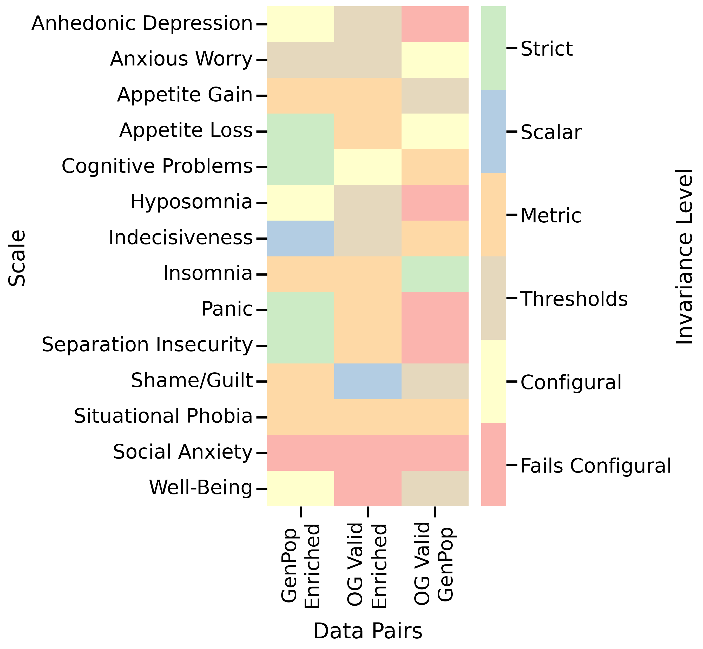
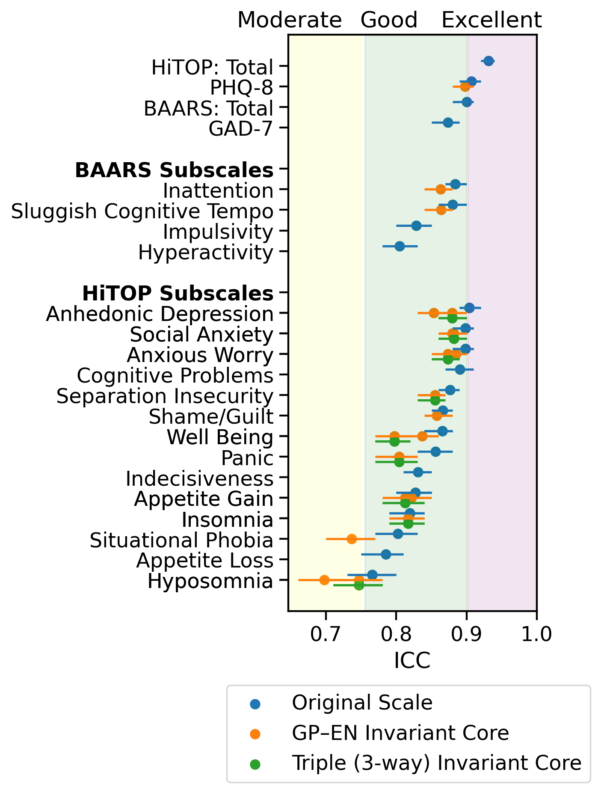
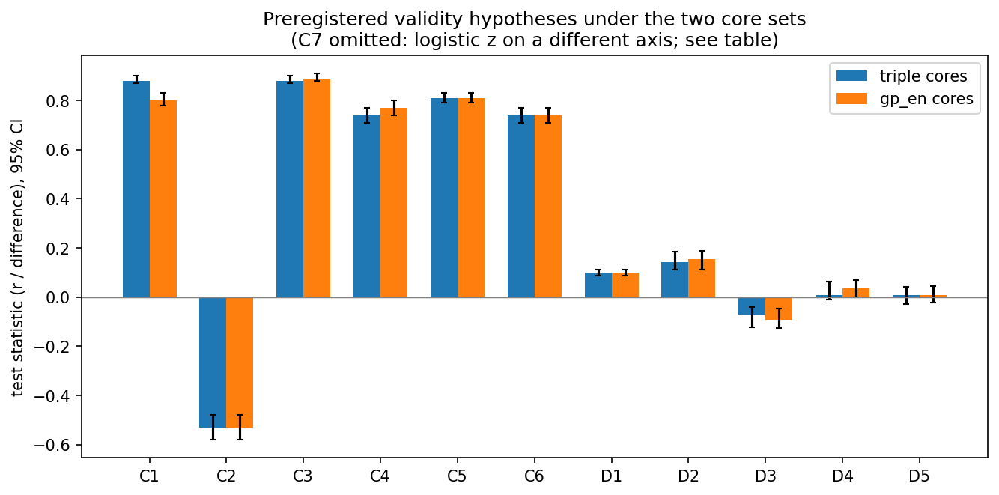
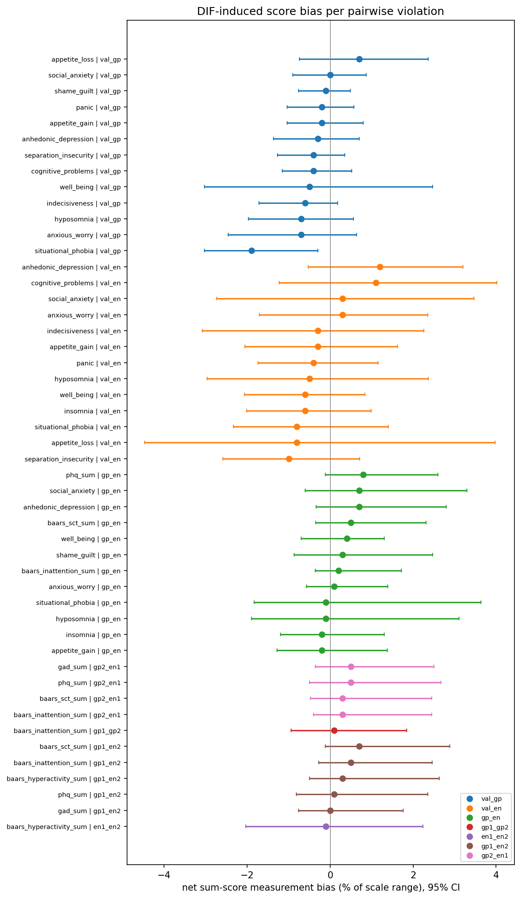
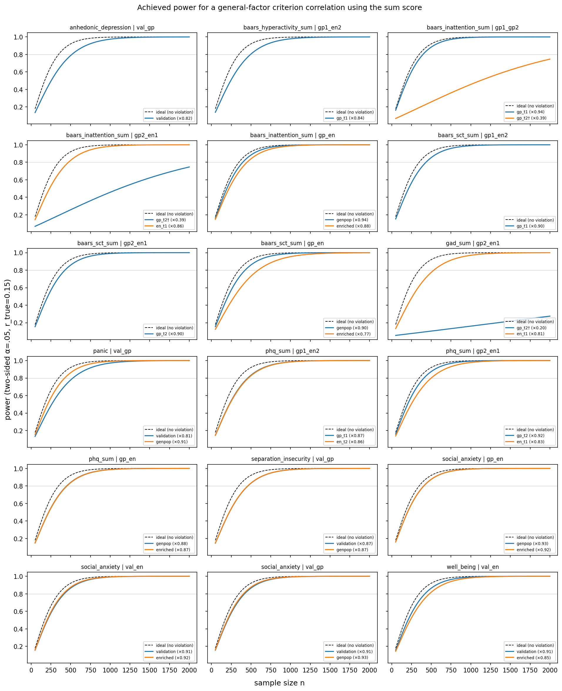
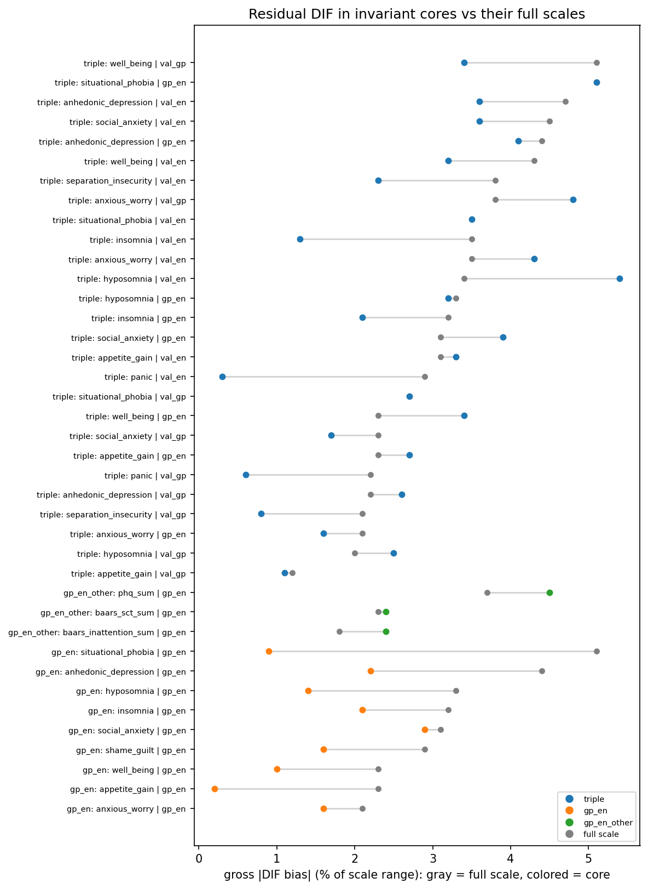

# Results: Test–retest reliability and measurement invariance of HiTOP internalizing scales (2-week window)

All analyses use the corrected Wu–Estabrook measurement-invariance pipeline
(`src/hitop_cfa/`; see `HANDOFF_measeq_fix.md` for the correction record).
Every number below names the notebook that generated it, and every figure
caption names the notebook that drew it. Confirmatory vs exploratory status
follows the preregistration (`prereg.txt`); deviations from the
preregistered methods are listed explicitly in
[Methods deviations](#methods-deviations-from-the-preregistration).

## Top-level findings

1. **Cross-sample invariance broadly fails; within-sample cross-wave
   invariance broadly holds.** Under permutation-tested Wu–Estabrook
   ladders (1000 permutations, WLSMV), every one of the 14 HiTOP subscales
   fails full invariance somewhere across the three sample pairs (validation–GP,
   validation–EN, GP–EN); only impulsivity among the PHQ/GAD/BAARS scales
   survives every comparison. Meanwhile GP wave 1 vs wave 2 and EN wave 1
   vs wave 2 pass through strict invariance for nearly everything
   (`NB_2_cfa_as_reg.ipynb`, `NB_2_cfa_as_reg_other_*.ipynb`).
2. **Conventional ΔCFI/ΔRMSEA criteria see half of it, mislocalized —
   and ΔCFI alone sees almost none of it.** Across all scales and pairs
   (`NB_conventional_criteria.ipynb`), the joint
   ΔCFI ≥ −.01 / ΔRMSEA ≤ .015 rules detect 21 of the 40
   permutation-failing scale × pair cells (9/13 val_gp, 8/14 val_en,
   4/13 gp_en — plus one gp_en flag on a scale whose permutation ladder
   passes strict), frequently at the wrong tier (val_gp hyposomnia and
   panic flag at strict where the permutation ladder fails configural).
   ΔCFI alone detects 7 of 40. All 11 configural failures — including
   the PHQ-8 between GP and EN — are invisible to delta criteria by
   construction. Calibrated alternatives (RMSEA_D; McNeish-style dynamic
   cutoffs) recover all 29 delta-level failures and erase the
   pair-dependence, but at the 5% operating point flag 3–4 of the 8
   permutation-passing cells and mislocalise the level more often than
   the permutation ladder. See the conventional-criteria and calibrated-
   criteria sections below.
3. **Stepwise item removal restores invariance.** Between GP and EN, all
   14 HiTOP subscales reach a scalar-invariant core (5 already at full
   scale). Across all three samples simultaneously, 10 of 14 get a core
   (3 scalar-level, 7 metric-level fallback)
   (`NB_2_cfa_as_reg_gp_en.ipynb`, `NB_2_cfa_as_reg.ipynb`).
4. **The violations are real at item level but mostly cancel in sum
   scores.** 109 of 328 item DIF estimates have 95% CIs excluding zero,
   yet only 1 of 49 scale×pair net-bias CIs does (situational phobia,
   validation–GP: −0.29 points ≈ 1.9% of range), and gross bias never
   exceeds ~5% of scale range (`NB_invariance_effect_sizes.ipynb`).
5. **Dimensionality violations cost modest power, with one exception.**
   Most groups sit at ωH ≈ .70–.86 (criterion-correlation attenuation
   ×.84–.93; 1.2–1.5× required-n inflation). SCT in the enriched sample is
   the interpretable worst case: ωH = .59, 1.70× required-n inflation, and
   the sum conflates two factors (`NB_invariance_effect_sizes.ipynb`).
6. **Validity conclusions are robust to core scoring.** All seven
   preregistered convergent hypotheses (C1–C7) are supported under the
   original full scales, the triple cores, and the GP–EN cores alike;
   D1 and D2 are supported, D3–D5 are not, under all three scorings.
   15 of 16 hypothesis outcomes agree across the three scorings
   (`NB_core_effects.ipynb`).
7. **Test–retest reliability is good-to-excellent and survives item
   removal.** Combined-sample ICC(2,1): instrument totals .87–.93; HiTOP
   subscales .77–.90. Under both core sets (the preregistered GP–EN cores
   and the stricter triply invariant cores), invariant cores lose at most
   .07 ICC relative to their full scales (median loss ≈ .02)
   (`NB_3_ICC.ipynb`).

8. **Detection and consequence are different questions, and no decision
   rule bridges them.** Across all 48 scale × pair cells, consequential
   non-invariance is rare (median gross DIF bias 2.6% of range; 15/48
   cells by a generous composite). Fit-index *magnitudes* (ΔCFI, RMSEA_D)
   track DIF effect sizes moderately (ρ ≈ .55–.62) while permutation
   p-values do not (ρ ≈ .2–.3); yet as binary screens the calibrated
   rules and the permutation ladder all flag ~40 of 48 cells (precision
   for consequence ≈ .35), and the conventional cutoffs do worse than
   chance (κ = −.25), missing 11 of 15 consequential cells
   (`NB_practical_significance.ipynb`).

## Confirmatory vs exploratory

Per `prereg.txt`, the confirmatory analyses are:

| Analysis | Status | Where |
|---|---|---|
| Invariance ladder, validation vs GP wave 1 | **Confirmatory** | `NB_2_cfa_as_reg.ipynb` (V_GP rows) |
| Invariance ladder, GP wave 1 vs EN wave 1 | **Confirmatory** | `NB_2_cfa_as_reg.ipynb` (GP_EN rows), `NB_2_cfa_as_reg_gp_en.ipynb` |
| Invariance of PHQ-8 / GAD-7 / BAARS-IV subscales (GP–EN) | **Confirmatory** | `NB_2_cfa_as_reg_other_gp_en.ipynb` |
| Stepwise removal to a scalar-invariant core | **Confirmatory** (procedure modified; see deviations) | stepwise sections of the pipeline notebooks |
| ICC(2,1) per scale, GP / EN / combined, full scales and cores | **Confirmatory** (quantification only — no hypotheses) | `NB_3_ICC.ipynb`, `NB_icc_plots.ipynb` |
| C1–C7 convergent and D1–D5 divergent hypotheses with GP–EN cores | **Confirmatory** | `NB_core_effects.ipynb` (gp_en core set) |

Everything else is **exploratory**: the validation–EN pair; the 5-level
thresholds tier itself (see deviations); the wave and crossed-wave
comparisons (`NB_2_cfa_as_reg_other_{gp1_gp2,en1_en2,gp1_en2,gp2_en1}.ipynb`);
the exhaustive invariant-subset searches (`NB_2_cfa_exploratory.ipynb`,
`notebooks/run_exhaustive_scale.py`); all DIF/dimensionality/power effect
sizes and EFAs (`NB_invariance_effect_sizes.ipynb`); the PHQ-8 follow-up
(`NB_phq8_gp_en_followup.ipynb`); and the triple-core variant of the
validity hypotheses (`NB_core_effects.ipynb`, triple core set — a
sensitivity analysis; the prereg specifies GP–EN cores).

## Methods deviations from the preregistration

1. **Model identification.** The prereg specified the first item of each
   subscale as the marker item. The pipeline instead uses Wu & Estabrook
   (2016) identification for ordinal indicators
   (`semTools::measEq.syntax`, `ID.cat = "Wu.Estabrook.2016"`,
   `ID.fac = "std.lv"`, theta parameterization), which is the
   psychometrically correct identification for ordered-categorical
   invariance testing. Reason and record: `HANDOFF_measeq_fix.md`.
2. **Five-level ladder.** The prereg named four levels (configural,
   metric, scalar, strict). With ordinal indicators, threshold invariance
   is a distinct, prior level; the pipeline tests
   configural → thresholds → metric → scalar → strict.
3. **Permutation machinery at scalar/strict.** Wu–Estabrook encodes
   scalar/strict constraints by *fixing* parameters rather than equality
   constraints, so `permuteMeasEq`'s parameter-targeted tests are
   undefined there; the pipeline uses the parameter-free omnibus
   permutation test at those levels, and `lavaan::modindices()` score
   tests (rather than "permuted maximum modification index") to choose
   stepwise removals at the scalar tier. Removals at the thresholds tier
   use permuted MIs as preregistered.
4. **Scales without an invariant core in the validity tests.** The prereg
   says such scales' hypotheses should be tested in the enriched sample
   only; the analysis code instead falls back to the full scale with a
   printed warning (affects the triple core set only:
   appetite_loss, cognitive_problems, indecisiveness, shame_guilt — see
   the resolution table printed in `NB_core_effects.ipynb`). Under the
   confirmatory GP–EN core set every scale has a core, so no fallback is
   triggered there.
5. **Secondary fit criteria.** The prereg's "RMSEA < 0.6" is treated as
   the evident typo for .06; the pipeline reads robust CFI/TLI ≥ .95 and
   robust RMSEA ≤ .06 via `fitMeasures`.

## Samples

From `NB_1_preprocess_and_descriptive.ipynb`: validation sample n = 496
(Watson et al., 2022; mean age 31.7). YouGov general-population sample:
500 recruited → 497 retained for the CFA analyses (grid attention check at
first visit) and 398 for ICC (grid checks at both visits); mean age 51.1.
Enriched sample (screened for diagnosed, currently bothersome
depression/anxiety/ADHD): 310 → 305 (CFA) and 255 (ICC); mean age 41.0.
Mean retest gap ≈ 9.5 days (GP) and 8.5 days (EN).

## Full-scale invariance across samples (3-way)

Baselines in `data/cfa/orig_cfa_res.csv`, generated in
`NB_2_cfa_as_reg.ipynb` (1000-permutation Wu–Estabrook ladders; a level
"fails" at permutation p < .05; configural failures may continue via the
secondary fit criteria). First failing level per scale × pair:

| scale | V_GP (confirmatory) | GP_EN (confirmatory) | V_EN (exploratory) |
|---|---|---|---|
| anhedonic_depression | configural | thresholds | metric |
| anxious_worry | thresholds | metric | metric |
| appetite_gain | metric | scalar | scalar |
| appetite_loss | thresholds | **passes strict** | scalar |
| cognitive_problems | scalar | **passes strict** | thresholds |
| hyposomnia | configural | thresholds | metric |
| indecisiveness | scalar | strict | metric |
| insomnia | **passes strict** | scalar | scalar |
| panic | configural | **passes strict** | scalar |
| separation_insecurity | configural | **passes strict** | scalar |
| shame_guilt | metric | scalar | strict |
| situational_phobia | scalar | scalar | scalar |
| social_anxiety | configural | configural | configural |
| well_being | metric | thresholds | configural |

*Highest invariance level passed per scale × sample pair. Generated in
`notebooks/NB_invariance_plot.ipynb`.*

No HiTOP subscale passes strict invariance across all three pairs;
validation–GP (the time-window comparison) is the most damaging pair, with
five configural failures.

## GP–EN and the other instruments

The two-way GP–EN run (`NB_2_cfa_as_reg_gp_en.ipynb`, results in
`data/cfa_gp_en/`) reuses the 3-way GP_EN baselines and continues stepwise
per-pair: **all 14 HiTOP subscales reach a scalar-invariant core**, five of
them (appetite_loss, cognitive_problems, indecisiveness, panic,
separation_insecurity) at the full scale.

PHQ-8 / GAD-7 / BAARS-IV between GP and EN
(`NB_2_cfa_as_reg_other_gp_en.ipynb`, `data/cfa_other_gp_en/`):

- **Fail**: PHQ-8 (configural), inattention (configural), SCT
  (configural).
- **Pass through strict**: GAD-7, hyperactivity, impulsivity.
- Stepwise cores: PHQ-8 reaches only a metric-level fallback core
  {phq_1, phq_3, phq_4, phq_6, phq_7}; inattention a 6-item scalar core;
  SCT a 6-item scalar core.

The PHQ-8's GP–EN failure is notable because the PHQ-8 is routinely summed
across clinical and non-clinical strata; see the PHQ-8 follow-up section.

## Wave and crossed-wave comparisons (exploratory)

PHQ/GAD/BAARS on the recontact cohort (gridall; GP n = 398, EN n = 255),
from `data/cfa_other_*/orig_cfa_res.csv`, generated in
`NB_2_cfa_as_reg_other_{gp1_gp2,en1_en2,gp1_en2,gp2_en1}.ipynb`:

| scale | gp_en (wave 1) | gp1_gp2 | en1_en2 | gp1_en2 | gp2_en1 |
|---|---|---|---|---|---|
| phq_sum | configural | passes strict | passes strict | configural | configural |
| gad_sum | passes strict | passes strict | passes strict | thresholds | configural |
| inattention | configural | configural | passes strict | metric | configural |
| hyperactivity | passes strict | passes strict | configural | configural | passes strict |
| impulsivity | passes strict | passes strict | passes strict | passes strict | passes strict |
| sct | configural | passes strict | passes strict | configural | configural |

Three inferences the crossed cells support: (1) PHQ-8 and SCT fail in
*every* cell crossing the sample boundary and pass in every within-sample
cell — the sample effect replicates across wave pairings and cohorts;
(2) failures localize to single anomalous groups where they are not sample
effects — hyperactivity tracks **en_t2** (fails exactly in the two cells
containing it), inattention tracks **gp_t2**; (3) the exposure hypothesis
(prior exposure at wave 1 improving gp2_en1 invariance) is refuted. GAD-7
is the one fragile case: it passes strict on the full wave-1 samples but
fails in both crossed recontact cells.

## Invariant cores

Full inventory (items kept/removed per core, both sets):
`data/core_effects/core_inventory.csv`, generated in
`NB_core_effects.ipynb`. Both core sets are **stepwise-only** (author
decision; exhaustive refinements are reported below as exploratory
alternatives but not consumed downstream).

- **Triple cores** (invariant across validation, GP, and EN;
  `data/cfa/stepwise_scalar.pkl`, from `NB_2_cfa_as_reg.ipynb`): scalar
  cores for insomnia (3 items), panic (3), separation_insecurity (6);
  metric-level fallback cores for anhedonic_depression (6), anxious_worry
  (3), appetite_gain (3), hyposomnia (4), situational_phobia (5 = full
  scale), social_anxiety (6), well_being (3). No core for appetite_loss,
  cognitive_problems, indecisiveness, shame_guilt (3–4-item scales cannot
  drop below the 3-item floor).
- **GP–EN cores** (`data/cfa_gp_en/stepwise_scalar.pkl` and
  `data/cfa_other_gp_en/stepwise_scalar.pkl`): scalar cores for all 14
  HiTOP subscales, plus inattention (6 items) and SCT (6); PHQ-8 gets the
  stepwise **metric** fallback {phq_1, phq_3, phq_4, phq_6, phq_7}.

Reporting rule carried on every core row (`core_level`): latent mean
comparisons should use scalar-level cores only; metric-level cores are
adequate for correlations and reliability.

## Exhaustive invariant-subset searches (exploratory)

The exhaustive search (val_gp-first early abandon, calibrated parametric
delta screen α = .005, stepwise configural-certificate size caps; driven by
`NB_2_cfa_exploratory.ipynb` / `notebooks/run_exhaustive_scale.py`,
progress pickles in `data/cfa/`) targets scalar invariance across all
three pairs. Status: **complete for all 14 scales** (social_anxiety and
well_being ran on Biowulf per `HPC.md`, pickles copied home 2026-08;
anhedonic_depression completed locally 2026-09-28 after the
degenerate-fit guard — commit b120880 — unblocked its final size-3 tier,
where exactly one combination was refuted as `degenerate`).

- **Any triply scalar-invariant subset exists** for 6 scales:
  insomnia (3 items), panic (four 3-item subsets),
  separation_insecurity (**7 items** — one more than the stepwise core
  retained), situational_phobia (3 items), social_anxiety (one 4-item
  subset: {hitop114, hitop117, hitop129, hitop204}), well_being (two
  3-item subsets: {hitop54, hitop244, hitop250} and
  {hitop106, hitop244, hitop250}).
- **Proven none exists** (all ≥3-item subsets refuted):
  anhedonic_depression (967 combinations tested), anxious_worry,
  appetite_gain, appetite_loss, cognitive_problems, hyposomnia,
  indecisiveness, shame_guilt.
- The social_anxiety result sharpens the SR contrast below: the full
  scale and the SR's 5-item composition fail configural in every pair,
  yet a 4-item triply scalar-invariant subset exists — it shares only
  hitop114 and hitop129 with the SR selection.
- **Other scales (gp_en-only searches; completed 2026-09-29,
  `data/cfa/other_scales_exhaustive.pkl`)**: PHQ-8's unique 5-item
  scalar subset {phq_1, 2, 4, 6, 8} is independently reproduced (all
  7- and 6-item subsets refuted), confirming the stepwise metric
  fallback {phq_1, 3, 4, 6, 7} is not scalar-capable; inattention has
  eight 6-item scalar subsets (all 8- and 7-item subsets refuted; the
  stepwise core is among the eight); SCT has exactly two (the stepwise
  core {sct_1, 3, 4, 5, 6, 8} and {sct_1, 3, 4, 5, 7, 9}). GAD-7,
  hyperactivity, and impulsivity pass strict at full scale and need no
  search. Cores remain stepwise-only downstream; the annotated
  exhaustive choices are documentation.
- The GP–EN-only exhaustive PHQ-8 search
  (`NB_phq8_gp_en_followup.ipynb`) found exactly one scalar-invariant
  5-item core: {phq_1, phq_2, phq_4, phq_6, phq_8}. This is an
  exploratory alternative to the stepwise metric fallback used in the
  consolidated cores.

## Test–retest reliability (ICC)

ICC(2,1) with 95% CIs, computed in `NB_3_ICC.ipynb` on the recontact
cohort (GP and EN separately and combined; tables in `data/icc/`).
Combined-sample highlights: HiTOP total .93 [.92, .94]; PHQ-8 .91; BAARS
total .90; GAD-7 .87; HiTOP subscales range .77 (hyposomnia) to .90
(anhedonic depression, anxious worry, social anxiety).

Core ICCs are reported for **both core sets**. The **GP–EN cores** are the
preregistered set for this analysis (the prereg ties combined-sample core
ICCs to GP–EN invariance): the 9 reduced cores span .70–.88, with the
largest drops on the two 3-item cores — hyposomnia .77 → .70 and
situational phobia .80 → .74 — and anhedonic depression .90 → .85; the
other five scales are full-scale invariant between GP and EN, so their
full-scale ICCs stand. The **triply invariant cores** (exploratory here;
stricter derivation) span .75–.88, largest drops well_being .87 → .80 and
panic .86 → .80. The **EN–VAL pairwise cores** (exploratory; from
`NB_2_cfa_as_reg_en_val.ipynb`) span .68–.87 across their 9 reduced
cores, the lowest being the 3-item hyposomnia core (.77 → .68) and
anhedonic depression's 3-item core (.90 → .81). Under every set the
reliability cost of item removal stays under .10 ICC (usually ≤ .03), and
the other-scale cores barely move (PHQ-8 .91 → .90, inattention
.88 → .86, SCT .88 → .86).

*ICC(2,1) with 95% CIs, combined GP+EN sample: full scales vs the
preregistered GP–EN cores, the triply invariant cores, and the EN–VAL
pairwise cores, with Koo–Li interpretive bands. Generated in
`notebooks/NB_icc_plots.ipynb`.*

## Convergent and divergent validity with invariant cores

`NB_core_effects.ipynb` runs the preregistered hypotheses (via
`hitop_cfa.convdiv`, a faithful extraction of `NB_4_convdiv.ipynb`) four
times: with the confirmatory **GP–EN cores** (criterion sums also
core-based: PHQ-8 from its metric core, BAARS total using the inattention
core), with the exploratory **triple cores** and **EN–VAL pairwise cores**
(criteria full-scale in both), and with the **original full scales** (no
core substitution) as the reference scoring. Tables:
`data/core_effects/convdiv_{gp_en,triple,en_val,full_scale}.csv`.

**Convergent (all seven supported under all four scorings):** C1
anhedonic depression ~ PHQ-8 Spearman r = .90 (full) / .88 (triple) / .80
(gp_en cores) / .78 (en_val cores); C2 well-being ~ PHQ-8 r = −.55 / −.53
/ −.53 / −.49; C3 anxious worry ~ GAD-7 r = .90 / .88 / .89 / .87; C4
appetite ~ PHQ item 5 r = .74–.77; C5 cognitive problems ~ PHQ item 7
r = .81 (all); C6 insomnia ~ PHQ item 3 r = .71 (full) / .74 (all cores);
C7 HiTOP sum predicting mood/anxiety-bothered, z ≈ 14.3–14.5, p < 1e-45
(and within each sample separately).

**Divergent (1000 stratified permutations, 1000 bootstraps):**

| hypothesis | full scales | gp_en cores | triple cores | en_val cores | verdict |
|---|---|---|---|---|---|
| D1 HiTOP↔GAD/PHQ > HiTOP↔BAARS | Δρ = .105, p = .001 | Δρ = .101, p = .001 | Δρ = .100, p = .001 | Δρ = .092, p = .001 | **supported** |
| D2 HiTOP → mood/anx-bothered > attention-bothered | ΔMI = .196, p = .001 | ΔMI = .153, p = .001 | ΔMI = .141, p = .001 | ΔMI = .147, p = .001 | **supported** |
| D3 BAARS → attention > mood/anx | ΔMI = −.071, p = .98 | ΔMI = −.094, p = 1.0 | ΔMI = −.071, p = .98 | ΔMI = −.071, p = .98 | **not supported** (direction reversed: BAARS predicted mood/anxiety-bothered slightly *better*) |
| D4 HiTOP-mood → mood > anxiety | ΔMI = .027, p = .16 | ΔMI = .034, p = .11 | ΔMI = .008, p = .51 | ΔMI = .008, p = .51 | not supported |
| D5 HiTOP-anx → anxiety > mood | ΔMI = −.002, p = .36 | ΔMI = .007, p = .18 | ΔMI = .009, p = .16 | ΔMI = −.001, p = .32 | not supported |

The exploratory single-scale variants: exd5 (anxious worry alone → anxiety
specificity) is supported under all four scorings; exd4 (anhedonic
depression alone → mood specificity) is supported under the full scales
(p = .013) and triple cores (p = .040) but not the gp_en cores (p = .15)
or the en_val cores (p = .36) — the sole hypothesis whose outcome differs
(15/16 agree across all four). Core scoring therefore changes no
preregistered validity conclusion relative to full-scale scoring.

*Point estimates with 95% CIs per hypothesis × scoring (original full
scales, GP–EN cores, triple cores, EN–VAL cores; colors match the ICC
forest). Generated in `notebooks/NB_core_effects.ipynb`.*

## Effect sizes of the invariance violations (exploratory)

All from `NB_invariance_effect_sizes.ipynb` (tables in
`data/effect_sizes/`).

**Item DIF and sum-score bias.** For all 49 pairwise full-scale violations
(13 val_gp, 13 val_en, 12 gp_en, 11 wave/crossed), a metric-model
decomposition separates the real latent severity gap from DIF-induced
score bias, with 95% CIs simulated from the robust parameter covariance.
109/328 item DIF estimates have CIs excluding zero — the violations are
real — but item effects cancel in the sums: only situational phobia
(val_gp) has a net-bias CI excluding zero (−0.29 points ≈ 1.9% of its
range), and gross |bias| never exceeds 5.1% of range.

*Net sum-score bias (% of scale range, 95% CI) per pairwise violation.
Generated in `notebooks/NB_invariance_effect_sizes.ipynb`.*

**Dimensionality (configural failures).** Per-group polychoric EFAs over
the 11 configural-failing scales (40 group rows) show the extra dimension
almost always lives on the enriched side: SCT is the extreme case
(second eigenvalue 1.11–1.17; 1-factor CFI .65–.73), the PHQ-8's enriched
somatic/affective split replicates across gp_en, gp1_en2, and gp2_en1, and
hyposomnia (genpop side) is the lone exception. Converting the 2-factor
solutions to effect sizes via the exact Schmid–Leiman identity: most
groups have ωH .70–.86 (criterion-correlation attenuation ×.84–.93;
required-n inflation 1.2–1.5×); SCT-enriched has φ = .52, ωH = .59 —
×.77 attenuation and **1.70× required-n inflation**, vs 1.23× in genpop.
The 8 groups whose 2-factor EFA fails to converge (SCT/hyperactivity
enriched waves, hyposomnia both val_gp groups) are the worst cases and
resist even 2-factor description.

*Power for detecting a general-factor criterion correlation (r = .15,
two-sided α = .05) using the sum score, per group, vs the unattenuated
ideal. Flat, dagger-flagged lines are φ ≈ 0 groups where the general
factor is undefined (read the conflation range instead). Generated in
`notebooks/NB_invariance_effect_sizes.ipynb`.*

## Effects in the invariant cores (exploratory)

`NB_core_effects.ipynb` reruns the effect-size suite on both core sets
(tables in `data/core_effects/`):

- **Residual DIF.** All 50 core × pair metric models converge. Item-level
  DIF CIs excluding zero drop from 33% (109/328) on the full scales to
  21% (46/218) in the cores; net-bias CIs excluding zero drop to the same
  single row (situational phobia val_gp, whose triple "core" *is* the
  full scale — stepwise removed nothing); gross bias stays ≤ 5.4% of
  range. Mean gross-bias reduction vs the matched full-scale violations
  is 0.58 percentage points of scale range (12 of 41 matched rows tick
  up slightly — item removal shrinks the denominator too).
- **Dimensionality.** Most cores are too short for the 2-factor check
  (46 of 70 core × group rows are 3–4 items, structurally excluded). Among
  the checkable ones, some enriched-group multidimensionality survives
  the repair (e.g., the gp_en separation-insecurity core in EN: ωH = .54;
  the triple anhedonic core in EN: ωH = .59). The gp_en anxious-worry
  core in genpop shows φ = .10 — a low-φ case where ωH overstates damage
  and the conflation-range reading applies. Power translations in
  `data/core_effects/power_cores.csv`.

*Gross |DIF bias| (% of scale range): full scale (gray) vs invariant core
(colored), where a matched full-scale violation exists. Generated in
`notebooks/NB_core_effects.ipynb`.*

## PHQ-8 follow-up (exploratory)

From `NB_phq8_gp_en_followup.ipynb` (`data/cfa_phq8_followup/`):

- **Conventional delta criteria see nothing for these instruments.**
  Under the ΔCFI ≥ −.01 / ΔRMSEA ≤ .015 screen, every PHQ/GAD/BAARS
  scale — including the three permutation-test failures — passes every
  delta level between GP and EN (their failures are configural, where
  delta criteria do not apply; see the full-screen section below).
- **The failure is a dimensionality asymmetry.** Enriched-group EFA splits
  the PHQ-8 into somatic and affective factors (replicated in the wave
  data; see the EFA section above).
- **Item DIF is real but balanced**: worst items phq_7 (concentration,
  signed bias +0.21 points) and phq_8 (psychomotor, −0.15, dMACS ≈ .20);
  effects cancel to a negligible net sum bias.
- **An exhaustively verified 5-item scalar core exists**:
  {phq_1, phq_2, phq_4, phq_6, phq_8} — the only scalar-invariant PHQ
  subset of any size between GP and EN at 1000 permutations
  (independently reproduced by the other-scales exhaustive search in
  `NB_2_cfa_exploratory.ipynb`, 2026-09-29, which exhaustively refuted
  all 7- and 6-item subsets).

## Conventional ΔCFI/ΔRMSEA screen, all scales × all pairs (exploratory)

`NB_conventional_criteria.ipynb` runs the conventional-criteria screen
on every scale × pair: the 14 HiTOP scales on val_gp, val_en, and
gp_en, plus PHQ-8/GAD-7/BAARS on gp_en (the validation sample lacks
those instruments). Scaled CFI/RMSEA per Wu–Estabrook level,
adjacent-level ΔCFI ≥ −.010 (Cheung & Rensvold, 2002) and
ΔRMSEA ≤ .015 (Chen, 2007). Table:
`data/cfa_conventional_criteria/laxer_criteria_screen.csv` (supersedes
the earlier gp_en-only screen in `data/cfa_phq8_followup/`). Reference
comparison: the permutation ladders, under which 40 scale × pair cells
fail somewhere (13 val_gp, 14 val_en, 13 gp_en).

- **Joint ΔCFI/ΔRMSEA detects 21 of the 40 failing cells** — but the
  sensitivity is pair-dependent: 9/13 on val_gp and 8/14 on val_en
  (the time-window comparisons, where violations are large), vs 4/13
  on gp_en (the population-strata comparison), where the criteria also
  flag appetite_loss (ΔRMSEA +.018 at thresholds), a scale the
  permutation ladder passes through strict.
- **When the criteria do flag, they often mislocalize the level.**
  On val_gp, hyposomnia and panic first flag at *strict* where the
  permutation ladder fails *configural* — a practitioner would conclude
  the factor structure is common and only residuals differ, when the
  structure itself differs; anxious worry and well-being flag one tier
  late. Exact-tier agreement occurs in roughly half the 21 detections.
- **ΔCFI alone — the criterion most applied papers rely on — detects
  7 of 40** (val_gp: hyposomnia, panic, situational_phobia,
  well_being; val_en: hyposomnia, situational_phobia; gp_en:
  situational_phobia, −.0121 at scalar).
- **On gp_en the ΔRMSEA flags are mechanical artifacts of small
  scales**: the configural (or thresholds) model of a 3–5-item scale is
  saturated or nearly so, RMSEA starts at an artificial floor of ~0,
  and the next tier's ordinary sampling noise reads as a ΔRMSEA
  excursion — the appetite_loss flag (χ²(3) = 3.38, p ≈ .34) and
  appetite_gain's metric flag (χ²(11) = 13.21, p ≈ .28) carry no χ²
  evidence at all. On the val pairs, by contrast, ΔRMSEA flags land on
  large scales with real signal (anxious worry: χ²(47) = 230). The
  cutoffs are therefore not merely insensitive but **uncalibrated,
  erring in both directions with model size and violation size**
  (cf. Jorgensen et al., 2018, on inconsistent Type I error).
- **All 11 configural failures (5 val_gp, 2 val_en, 4 gp_en — including
  the PHQ-8) are invisible to delta criteria by construction** — there
  is no lower level to difference against. At the configural level
  itself the verdict depends entirely on which absolute-fit rule a
  practitioner applies: the gp_en four all pass scaled CFI ≥ .95 (SCT
  marginal, .9496) while all fail scaled RMSEA ≤ .06 (.09–.15).
- Provenance note: an earlier gp_en-only version of this screen lives in
  `data/cfa_phq8_followup/laxer_criteria_screen.csv`
  (`NB_phq8_gp_en_followup.ipynb`); this all-pairs table reproduces its
  gp_en rows exactly.

## Calibrated alternatives to the fixed cutoffs: RMSEA_D and dynamic (DMI) cutoffs (exploratory)

`NB_calibrated_criteria.ipynb` re-judges the same 48 scale × pair cells
as the conventional screen with two calibrated alternatives, plus the
parametric scaled-Δχ² likelihood-ratio test as a reference:

- **RMSEA_D** — the RMSEA of the chi-square *difference* test rather
  than the difference of two RMSEAs (Savalei, Brace & Fouladi, 2023),
  in its multiple-group form √[G(ΔT − Δdf)/(Δdf(N − G))] (Beribisky &
  Hancock, 2024), computed from the scaled Δχ² of `lavTestLRT` and
  screened at the conventional RMSEA benchmarks .05 and .08 (no RMSEA_D
  cutoff is established in the literature). lavaan's own `lavTestLRT`
  RMSEA column applies the same formula to the *unscaled* Δχ² and is
  recorded alongside.
- **Dynamic measurement-invariance cutoffs** (McNeish, 2026): for each
  ladder step, 500 datasets are simulated from the fitted *constrained*
  model of that step (loadings, residual variances, factor means and
  variances, thresholds; observed group sizes), both models are refit to
  each replicate, and the 5th percentile of the null ΔCFI and the 95th
  percentile of the null ΔRMSEA (also 1st/99th) become the cutoffs.
  McNeish defines the method for continuous ML indicators; here it is
  extended to the ordinal WLSMV ladders by simulating latent responses
  and categorising at the fitted thresholds (R function `dmi_null`,
  parallelised; all 500 replicates converged in every transition but one,
  497/500).

Tables: `data/cfa_calibrated_criteria/calibrated_screen.csv` (192
transitions), `summary_vs_permutation.csv`, `verdicts_by_method.csv`;
null draws in `dmi_null_draws.pkl`. Reference: the permutation ladders,
under which 29 cells fail at a delta level, 11 fail at configural (which
no delta-based rule can see directly), and 8 pass strict.

| rule | detects (of 29 delta-level failures) | exact level | configural-failing scales flagged at some level (of 11) | flags on the 8 permutation-passing cells |
|---|---|---|---|---|
| conventional ΔCFI ≥ −.01 / ΔRMSEA ≤ .015 | 19 | 12 | 2 | 1 |
| scaled Δχ² LRT, p < .05 | 29 | 29 | 10 | 4 |
| RMSEA_D > .05 | 29 | 24 | 10 | 4 |
| RMSEA_D > .08 | 26 | 15 | 7 | 0 |
| DMI 5% (ΔCFI or ΔRMSEA) | 29 | 20 | 11 | 3 |
| DMI 5%, ΔCFI only | 29 | 21 | 11 | 3 |
| DMI 5%, ΔRMSEA only | 15 | 9 | 1 | 0 |
| DMI 1% | 27 | 19 | 7 | 0 |

- **Calibration restores the sensitivity the fixed cutoffs threw away.**
  The fit indices carried the information all along: RMSEA_D (> .05) and
  DMI (5%) detect all 29 delta-level failures that the conventional rules
  detect 19 of, and DMI flags every one of the 11 configural-failing
  scales at some later step (conventional: 2). The **pair-dependence
  disappears**: by pair, conventional detection is 7/8 (val_gp), 8/12
  (val_en), 4/9 (gp_en) against 8/8, 12/12, 9/9 for RMSEA_D(.05), DMI(5%)
  and the LRT alike — the population-strata insensitivity was a property
  of the cutoffs, not of the data.
- **The small-scale ΔRMSEA artifacts vanish.** The appetite_loss gp_en
  conventional flag (observed ΔRMSEA +.018) passes every calibrated
  rule; its DMI null 95th percentile for that saturated-baseline step is
  +.066.
- **But calibrated delta criteria are not a substitute for the
  calibrated test.** At the 5% operating point RMSEA_D(.05) and the LRT
  flag 4 of the 8 permutation-passing cells (GAD-7, hyperactivity and
  separation insecurity on gp_en, insomnia on val_gp — all at the strict
  step), and DMI(5%) flags 3 (GAD-7 and separation insecurity at
  thresholds, insomnia at strict). Exact-level agreement with the
  permutation ladder is 20/29 for DMI and 24/29 for RMSEA_D — DMI tends
  to flag at *thresholds* where the permutation ladder localises the
  failure to metric or scalar. The stricter settings (RMSEA_D > .08,
  DMI 1%) remove the spurious flags at the cost of 2–3 misses and
  poorer localisation. The parametric LRT is the only rule with 29/29
  exact localisation but carries the same 4/8 flags on passing cells —
  the Type I behaviour of the scaled difference test at the
  Wu–Estabrook scalar/strict steps (where constraints are encoded by
  fixing parameters) that motivated the permutation null in the first
  place.
- **DMI's power is entirely ΔCFI.** With tailored cutoffs ΔCFI alone
  detects 29/29; ΔRMSEA alone detects 15/29 even when calibrated,
  consistent with the structural critique of ΔRMSEA (Savalei et al.,
  2023; Beribisky & Hancock, 2024).
- Prescription that follows: fixed ΔAFI cutoffs discard information
  (uncalibrated in both directions); model-tailored cutoffs recover it;
  calibrated error control and correct localisation of the failing level
  still require a permutation (or exact) test.

## Decision rules vs practical significance (exploratory)

`NB_practical_significance.ipynb` asks a different question of the same
48 scale × pair cells: not "which rule agrees with the permutation
ladder?" but "which rule flags the cells where non-invariance actually
distorts scores?" The conventional ΔCFI cutoff was proposed as a
practical-significance screen (Cheung & Rensvold, 2002), so this is the
test it should be held to. Consequences are quantified for *every* cell
(not only the permutation failures, as in the effect-size section) with
the metric-model DIF decomposition — gross and net DIF-induced sum-score
bias as % of scale range, whether the net-bias 95% CI excludes zero, and
the largest item dMACS — plus the ωH-based criterion-correlation
attenuation for configural-failing scales. Tables:
`data/practical_significance/{dif_all_cells,cells_effects_and_rules,
spearman_severity_vs_effect,criteria_vs_practical}.csv`.

**Consequential non-invariance is rare.** Across the 48 cells the median
gross bias is 2.6% of range (max 5.2%), the median largest-item dMACS is
.17 (max .49), one cell has a net-bias CI excluding zero (situational
phobia, val_gp), two exceed 5% gross bias, and 12 (the configural
failures) have attenuation ≤ .90. A generous composite ("any": dMACS ≥
.40, or gross ≥ 5%, or net CI excludes zero, or attenuation ≤ .90) marks
15 of 48 cells.

**Fit-index magnitudes track consequence; p-values do not.** Spearman ρ
between each rule's continuous severity (its most extreme value across
the ladder) and the consequence measures:

| severity | gross bias % | max dMACS | abs net bias % |
|---|---|---|---|
| conventional: −min ΔCFI | .59 | .60 | .39 |
| conventional: max ΔRMSEA | .15 | −.05 | .30 |
| RMSEA_D: max | .60 | .53 | .38 |
| DMI: ΔCFI margin below null | .56 | .62 | .40 |
| DMI: ΔRMSEA margin | .25 | .13 | .36 |
| scaled-Δχ² LRT: −log10 min p | .54 | .61 | .32 |
| permutation: −log10 min p | .21 | .27 | .26 |

ΔCFI as a *continuous* index is as good a proxy for DIF magnitude as
RMSEA_D (ρ ≈ .55–.62) — Cheung & Rensvold's intuition was sound — while
ΔRMSEA in any form barely tracks it, and the permutation p-value, which
measures evidence against exact invariance rather than its size, tracks
it least (ρ ≈ .2–.3).

**But as binary screens, no rule — including the permutation ladder —
has useful precision for consequence, and the conventional rule is the
worst of them.** Against the composite definition (15 consequential of
48): conventional precision .18, recall .27, κ = −.25 (below chance; it
misses 11 of 15 consequential cells, including every dimensionality
failure — recall .08 against the attenuation criterion — while flagging
the small-df artifacts); the sensitive rules flag 40–43 of 48 cells and so
reach recall .93–1.00 at precision ≈ .33–.35 (permutation .35/.93,
DMI 5% .35/1.00, RMSEA_D > .05 .33/.93); the mid-sensitivity RMSEA_D >
.08 is the best-calibrated binary rule against moderate-effect
definitions (κ = .44 for gross ≥ 2.5%, .38 for dMACS ≥ .20) but drops to
.30/.67 on the composite. Against the strict definitions (dMACS ≥ .40,
gross ≥ 5%, net CI) every rule's precision is ≤ .09 — the conventional
rule's nominal edge there is only that it flags fewer cells (κ ≤ .10).

**Reading.** (1) The paper's central claim is now quantitative: rules
that test exact invariance — calibrated or not — flag roughly three
times as many cells as have any detectable consequence for scores, so
detection must be paired with effect sizes, not read as impact. (2) The
hypothesis that fixed ΔCFI/ΔRMSEA cutoffs are "really" crude
effect-size screens is refuted at the decision level: the −.01 cutoff sits
where it misses most consequential cells yet still fires on artifacts,
even though the ΔCFI index itself tracks consequence. (3) The resulting
prescription has three parts — a calibrated test (permutation) for
detection and level, continuous DIF effect sizes (dMACS, net bias) for
consequence, and fit-index magnitudes at most as a rough proxy, never as
fixed cutoffs. Caveats: the DIF measures capture threshold/intercept DIF
on sums and (via attenuation) configural failures, so loading-only
(metric) violations are inconsequential by construction here; the
consequence definitions are thresholds on continuous quantities with
small base rates, so precision estimates are coarse; and the 48 cells
share scales across pairs and are not independent.

## HiTOP-SR item crosswalk (exploratory)

The 83 fielded Phase-1 HiTOP items compared against the current HiTOP-SR
(jmgirard/hitop package, vendored under `external/`, gitignored; commit
recorded in the script). Generated by
`notebooks/build_hitopsr_crosswalk.py`; tables:
`data/hitopsr_crosswalk.csv` (item level — every fielded item plus all
369 never-fielded SR items as `sr_only` rows) and
`data/hitopsr_crosswalk_scales.csv` (scale level). Matching is by
normalized item text only: the SR's `Original` HiTOP_### ids come from a
different master pool than the internalizing-pool `hitopNN` ids used
here.

- **36 of 83 fielded items carried into the SR** (33 verbatim + 3
  curated content rewrites: hitop268 → "I had trouble falling asleep",
  hitop124 → "I got anxious when others were watching me",
  hitop220 → "I was ashamed of myself").
- **SR (sub)scales composed entirely of fielded items**: Insomnia (4/4,
  one rewrite), Situational Phobias (4/4), Anxious Worry (3/3),
  Appetite Loss (3/3 — identical to the fielded scale), Shame/Guilt
  (3/3, one rewrite), Social Anxiety (5/5, one rewrite); Well-being is
  4/5 (SR's "I felt motivated" was not fielded), Panic 3/5, Cognitive
  Problems 2/5, Manic Energy 2/7.
- **Constructs without an SR counterpart**: appetite_gain,
  indecisiveness, separation_insecurity. anhedonic_depression survives
  only as one item in each of the Anhedonia / Depressed Mood / Lassitude
  subscales of Distress-Dysphoria; hyposomnia's two mania-flavored items
  moved to Manic Energy (Internalizing-Thought Disorder spectrum); Social
  Anxiety and Well-being now sit under Detachment.
- **Invariance cores vs the consortium's retention choices** (cf.
  `data/core_effects/core_inventory.csv`): convergent for hyposomnia
  (the GP–EN stepwise removed exactly the two items — hitop181,
  hitop231 — that the SR reassigned to Manic Energy) and appetite_loss
  (unchanged in the SR, fully GP–EN invariant here); opposed for
  anhedonic_depression (the GP–EN scalar core shares zero items with the
  three SR survivors hitop84/93/157, which the stepwise removed) and
  panic (triple scalar core {104, 126, 215} vs SR-retained
  {126, 211, 257}).
- **Administration format is identical** (same prompt structure, same
  4-point Not at all / A little / Moderately / A lot options); only the
  reporting window differs (SR: last 12 months; fielded: last two
  weeks), so the fielded data speak directly to the SR item sets under a
  2-week window.

## HiTOP-SR-composition subsets: invariance and ICC (exploratory)

For every SR (sub)scale with >= 3 fielded items, the SR item composition
was scored from the fielded data and run through the same
1000-permutation Wu-Estabrook ladders (three pairs, WLSMV, strict max
level) and ICC(2,1) machinery as the main analysis. Script:
`notebooks/run_sr_subsets.py` (rehearsed at 50 permutations in
`data/rehearsal_sr_subsets/` first); results:
`data/cfa_sr_subsets/sr_cfa_res.csv` and
`data/cfa_sr_subsets/icc_sr_subsets.csv`. Rewritten SR items are proxied
by their fielded ancestors (hitop124, hitop220; sr_insomnia_verbatim
instead drops the rewritten item); SR Appetite Loss is item-identical to
the fielded appetite_loss scale and is not rerun. Not runnable
(< 3 fielded items): Cognitive Problems, Manic Energy, and the three
Distress-Dysphoria mood subscales.

First failing level per subset x pair (same convention as the main
table):

| SR subset (items) | V_GP | V_EN | GP_EN |
|---|---|---|---|
| sr_anxious_worry (3) | scalar | scalar | scalar |
| sr_situational_phobia (4) | scalar | scalar | scalar |
| sr_insomnia_verbatim (3) | scalar | configural (non-convergent) | configural (non-convergent) |
| sr_social_anxiety (5, 1 proxy) | configural | configural | configural |
| sr_shame_guilt (3, 1 proxy) | **passes strict** | **passes strict** | scalar |
| sr_well_being_partial (4 of 5) | metric | metric | metric |
| sr_panic_partial (3 of 5) | metric | scalar | **passes strict** |

Notable cells:

- **sr_shame_guilt passes strict invariance in both time-window
  comparisons** (V_GP p = .42, V_EN p = .87) — the SR's 3-item
  Shame/Guilt composition survives the 1-year-to-2-week change intact —
  but fails scalar between GP and EN (p = .031).
- **sr_insomnia_verbatim {hitop160, hitop254, hitop261} does not even
  converge at configural for V_EN or GP_EN**, whereas the stepwise core
  {160, 254, 268} was triply scalar-invariant: the item the SR retained
  verbatim (261, early waking) is the one the stepwise search removed,
  and the item the SR rewrote (268, sleep-onset) is the one that made
  the fielded core work.
- sr_social_anxiety fails configural everywhere (permutation p = .001 to
  .028 with robust RMSEA .18-.22), mirroring the full fielded scale —
  the SR's 5-item selection does not repair the structure, although a
  repair exists: the exhaustive search (above) found a triply
  scalar-invariant 4-item subset sharing only two items with the SR
  selection.
- The scalar wall dominates otherwise: sr_anxious_worry and
  sr_situational_phobia are metric-invariant in every pair but fail
  scalar in every pair, so under a 2-week window these SR compositions
  support correlational/reliability use but not observed-mean
  comparisons across these populations.
- sr_panic_partial (the 3 fielded of 5 SR panic items) passes strict
  between GP and EN, like the full fielded panic scale.

ICC(2,1), combined GP+EN recontact sample (n = 653; per-sample values in
the CSV): sr_social_anxiety .87, sr_anxious_worry .86, sr_shame_guilt
.85, sr_well_being_partial .84, sr_panic_partial .82,
sr_insomnia_verbatim .81, sr_situational_phobia .79 — all
good-to-excellent and closely tracking the parent full scales
(.77-.90).

### Practical impact of the SR-subset violations

The main analysis's effect-size suite applied to all 18 SR-subset
violations (`notebooks/run_sr_effect_sizes.py`; tables
`data/cfa_sr_subsets/sr_dif_{per_item,summary}.csv`,
`sr_efa_summary.csv`, `sr_dimensionality.csv`). All 18 metric models
converge — including the two insomnia cells whose configural models do
not (their DIF numbers, and those of the other configural-failing
cells, are order-of-magnitude approximations per the module caveat).

- **Item DIF is real but cancels in the sums, replicating the
  full-scale story.** 34 of 66 item signed-bias CIs exclude zero
  (a higher rate than the full scales' 109/328 — short subsets dilute
  less) yet only **1 of 18 net-bias CIs excludes zero**:
  sr_situational_phobia val_gp, net −0.35 points ≈ 2.9% of its 12-point
  range — the same scale × pair that was the sole exclusion among the
  49 full-scale violations. Gross |bias| never exceeds 6.5% of range.
- **Real severity gaps dwarf the measurement bias.** E.g.
  sr_anxious_worry gp_en: real latent gap 3.28 points vs net bias
  −0.01; sr_social_anxiety gp_en: 3.77 vs +0.10. Observed SR-subset sum
  differences between these groups are essentially all severity, not
  DIF.
- **Largest single-item effects**: hitop225 ("afraid of the dark"),
  dMACS .53 val_gp — the biggest DIF item in the SR subsets, and the
  main driver of the one significant net bias; hitop124 (the rewritten
  "watched/center of attention" proxy) dMACS .34 val_en.
- **Dimensionality (configural failures).** The 3-item insomnia cells
  are structurally excluded from the 2-factor check. sr_social_anxiety
  splits into an interaction-shyness factor (hitop1, hitop17) vs a
  being-observed/performance factor (hitop124, hitop129; hitop114
  cross-loads): validation φ = .65, ωH = .72 (attenuation ×.85,
  required-n inflation 1.40×); enriched φ = .74, ωH = .77 (×.88,
  1.30×); the genpop 2-factor EFA does not converge (the resists-even-
  2-factor worst case, as in the main analysis). Practical reading: the
  SR Social Anxiety sum under a 2-week window still mostly measures one
  thing (corr(sum, F1) ≈ corr(sum, F2) ≈ .85-.90), at a ~1.3-1.4×
  sample-size cost for general-factor criterion correlations.

## Provenance and pending items

- `NB_5_compare_to_archived.ipynb` is the pre-measEq regression harness;
  its equality assertions are *expected to fail* against the corrected
  pipeline and it is retained only as the refactor paper trail.
- `NB_4_convdiv.ipynb` is superseded for reporting by
  `NB_core_effects.ipynb` (same code via `hitop_cfa.convdiv`; NB_4 can
  now also run as written since `data/icc/cores.pkl` exists).
- The en_val two-way stepwise run (`NB_2_cfa_as_reg_en_val.ipynb`,
  results in `data/cfa_en_val/`) completed 2026-08: 12 of 14 scales reach
  a pair-specific core (10 scalar-level — including insomnia's 3-item
  core {160, 254, 268}, identical to the 3-way core — 2 metric;
  cognitive_problems and indecisiveness none).
- The gp_val two-way run (`NB_2_cfa_as_reg_gp_val.ipynb`): baseline
  ladders exist (`data/cfa_gp_val/orig_cfa_res.csv`, 2026-08-20,
  consistent with the 3-way V_GP rows) but the stepwise metric/scalar
  sections have not been run — pending only if a fourth pairwise core
  set is wanted.
- All exhaustive searches (14 HiTOP 3-way + the 3 gp_en other-scale
  failures) are complete and consolidated: `NB_2_cfa_exploratory.ipynb`
  rerun 2026-09-29 with refreshed review notes, producing
  `data/cfa/exhaustive_scalar.pkl` and
  `data/cfa/other_scales_exhaustive.pkl`.
